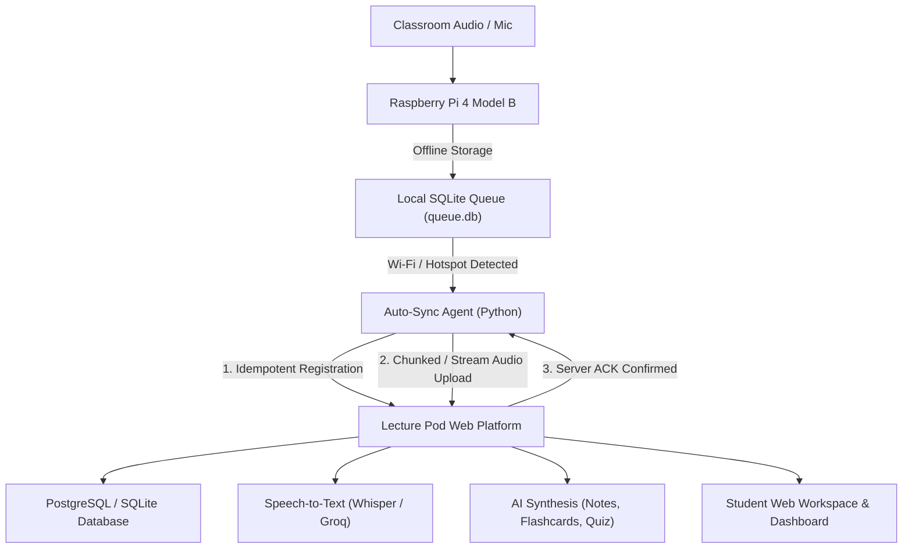

# Lecture Pod — Student Learning Platform & Raspberry Pi 4 Ecosystem

**Lecture Pod** is an AI-powered lecture recording and revision ecosystem designed for university students. It pairs with an offline-first **Raspberry Pi 4 Model B** recording pod to automatically capture classroom lectures, store audio offline, sync over Wi-Fi, and transform audio into structured notes, revision sheets, interactive flashcards, and quizzes.

---

## 1. System Architecture



---

## 2. Core Features Implemented & Verified

| Feature | Status | Description |
|---|---|---|
| **Marketing Landing Page** | Verified | Clean, minimal UI with soft off-white background, champagne gold accents, feature showcase, interactive UI preview, privacy section, and FAQ. |
| **Authentication & Profiles** | Verified | Student registration, login, logout, session persistence, user data isolation, and profile onboarding (college, branch, semester, preferred language). |
| **Multilingual Support** | Verified | English, Hindi, and Hinglish lecture recognition and synthesis preferences. |
| **Student Dashboard** | Verified | Real database metrics (saved lectures, processing queue, completed kits, Pi status), recent lectures, study reminders, and zero-fake empty states. |
| **Lecture Library** | Verified | Grid and list views, search by title/transcript, filter by subject/status, sort, audio player, edit metadata, delete confirmation, retry failed jobs. |
| **Individual Workspace (7 Tabs)** | Verified | **Overview** (summary, key concepts, timeline), **Audio Player** (seek, rate cycling, skip 10s), **Transcript** (timestamped segments, jump to audio), **AI Notes** (structured markdown with live autosave & .md export), **Flashcards** (3D flip, shuffle, mastery toggle), **Quiz** (transcript-derived multiple-choice, score calculation, explanations, review, retake), **Revision Sheet** (printable high-yield capsule). |
| **Raspberry Pi 4 Model B Agent** | Verified | Python daemon (`rpi-agent/lecturepod_agent.py`) with offline SQLite queue, automatic sync on Wi-Fi reconnect, exponential backoff, and heartbeat diagnostics. |
| **Device Pairing Protocol** | Verified | 6-character pairing codes (e.g., `LP-E285F1`), HMAC signed permanent device tokens, honest online/offline heartbeat detection. |
| **Global Search** | Verified | Database-backed search across lecture titles, subjects, spoken transcript segments, notes, and flashcards with deep links. |
| **Study Planner** | Verified | Lightweight revision task manager linked directly to captured lectures with target due dates. |
| **Data Privacy & Export** | Verified | Full student archive export in JSON format; row-level isolation ensuring students never see another student's data. |
| **Explicit Demo Mode** | Verified | "Load Sample Demo Lectures" button allowing instant testing with university-level engineering and science lectures without requiring hardware. |

---

## 3. Technology Stack

- **Frontend & App Framework:** Next.js 15 (App Router), React 19, TypeScript
- **Styling:** Tailwind CSS with custom champagne gold palette and minimal typography
- **Icons:** `lucide-react`
- **Database:**
  - **Local Development / Zero-Config:** Relational SQLite via `better-sqlite3` with WAL mode
  - **Cloud Production:** Supabase PostgreSQL with complete Row Level Security (RLS) migrations
- **Hardware Integration:** Python 3 agent for Raspberry Pi 4 Model B
- **AI Integrations:** OpenAI Whisper / Groq Whisper (STT) + OpenAI GPT-4o-mini / Gemini / Academic synthesis engine

---

## 4. Prerequisites

- **Node.js:** v18.0.0 or later (v24.15.0 verified)
- **npm:** v9.0.0 or later
- **Python:** v3.9+ (v3.11.9 verified for Raspberry Pi agent)
- **Optional for Cloud Deployment:** Supabase project account & API keys

---

## 5. Installation & Setup

1. **Clone the repository:**
   ```bash
   git clone <repo-url>
   cd lecturepod
   ```

2. **Install dependencies:**
   ```bash
   npm install
   ```

3. **Configure environment variables:**
   Copy `.env.example` to `.env.local`:
   ```bash
   cp .env.example .env.local
   ```

4. **Environment Variables Reference:**

   ```env
   # Base URL
   NEXT_PUBLIC_APP_URL=http://localhost:3000

   # Authentication & Session Security
   SESSION_SECRET=your_32_char_secret_key_here

   # Database Mode: "sqlite" (default local) or "supabase" (cloud PostgreSQL)
   DATABASE_MODE=sqlite

   # Supabase Configuration (Optional - only required if using Supabase Cloud)
   NEXT_PUBLIC_SUPABASE_URL=https://your-project.supabase.co
   NEXT_PUBLIC_SUPABASE_ANON_KEY=your-anon-key-here
   SUPABASE_SERVICE_ROLE_KEY=your-service-role-key-here

   # Storage Provider: "local" (saves to public/uploads/audio) or "supabase"
   STORAGE_PROVIDER=local

   # Speech-to-Text: "openai", "groq", or "mock" (default for offline dev)
   SPEECH_TO_TEXT_PROVIDER=mock
   OPENAI_API_KEY=
   GROQ_API_KEY=

   # LLM Provider: "openai", "gemini", or "template"
   LLM_PROVIDER=template
   GEMINI_API_KEY=

   # Device Hardware Salt
   DEVICE_API_SALT=lecturepod_rpi_device_salt_2025
   ```

---

## 6. Running the Application

### Development Mode
```bash
npm run dev
```
Open [http://localhost:3000](http://localhost:3000) in your browser.

### Production Build & Run
```bash
npm run build
npm run start
```

---

## 7. Database Migrations (Supabase PostgreSQL)

If deploying to Supabase:
1. Open your Supabase SQL Editor.
2. Execute the migration file located at:
   [`supabase/migrations/20251018000000_init_lecturepod.sql`](file:///g:/lecturepod/supabase/migrations/20251018000000_init_lecturepod.sql)
3. Set `DATABASE_MODE=supabase` in your production environment variables.

---

## 8. Raspberry Pi 4 Device Agent Setup

### Pairing the Device
1. Log in to the web platform and navigate to **Device Management** (`/devices`).
2. Click **Pair New Device** to generate a 6-character code (e.g., `LP-E285F1`).
3. On the Raspberry Pi terminal (or via SSH/VNC):
   ```bash
   python3 rpi-agent/lecturepod_agent.py pair --code LP-E285F1 --server http://<server-ip>:3000
   ```
4. The agent exchanges the code for a permanent cryptographic API token and saves `config.json`.

### Capturing an Offline Lecture
```bash
python3 rpi-agent/lecturepod_agent.py record --title "Operating Systems" --subject "Computer Science" --duration 3600
```
- Audio is saved in `rpi-agent/recordings/`.
- Metadata is inserted into `rpi-agent/queue.db`.
- If Wi-Fi is reachable, it auto-syncs immediately. If offline, it waits safely in the local queue.

### Running the Auto-Sync Daemon
```bash
python3 rpi-agent/lecturepod_agent.py daemon
```
To install as a systemd service that starts on boot, see [`rpi-agent/README.md`](file:///g:/lecturepod/rpi-agent/README.md).

---

## 9. Device-to-Server REST API Contract

| Endpoint | Method | Auth | Description |
|---|---|---|---|
| `/api/device/pair` | `POST` | None | Exchanges 6-char pairing code for permanent API token. |
| `/api/device/heartbeat` | `POST` | Bearer Token | Sends telemetry (online, CPU temp, IP, queue counts). |
| `/api/device/register-recording` | `POST` | Bearer Token | Idempotent registration using `device_recording_id`. |
| `/api/device/upload` | `POST` | Bearer Token | Multipart/form-data upload of audio recording. |
| `/api/device/ack` | `POST` | Bearer Token | Confirms server receipt and checksum verification. |
| `/api/device/error-report` | `POST` | Bearer Token | Transmits sync retry and network failure telemetry. |

---

## 10. How to Test the Complete Student Workflow

1. Navigate to `http://localhost:3000/`.
2. Click **Sign In** and click **"Demo Mode: Sign In with Sample Student Account"** (or click **Get Started** to register a fresh student profile).
3. Complete the onboarding screen selecting your preferred lecture language (English, Hindi, or Hinglish).
4. On the **Dashboard**, click **"Load Sample Demo Lectures"** to populate realistic coursework (Linear Algebra, Computer Networks, Thermodynamics).
5. Open any lecture in your **Lecture Library** to explore all 7 tabs:
   - **Overview:** Read the high-level summary and key concepts.
   - **Audio Player:** Play audio, test skip buttons, and adjust speed (1x to 2x).
   - **Transcript:** Click any timestamp badge to jump the audio player to that quote.
   - **AI Notes:** Edit notes in markdown and click **Save Notes** (autosaved).
   - **Flashcards:** Flip cards in 3D, shuffle the deck, and mark cards as Mastered.
   - **Practice Quiz:** Select answers, submit the quiz, review explanations, and view scored results.
   - **Revision Sheet:** Click **Print / Save PDF** to generate an exam study sheet.
6. Open **Device Management** (`/devices`) and click **Pair New Device** to test the pairing code generator.
7. Open **Global Search** (`/search`) and query `Eigenvalues` or `TCP` to inspect cross-resource search results.
8. Open **Settings & Privacy** (`/settings`) and click **Download JSON Archive** to export your complete database records.

---

## 11. Known Limitations & External Credentials

- **Speech-to-Text:** Configured to use academic fallback when `OPENAI_API_KEY` or `GROQ_API_KEY` is not present in `.env.local`. When an API key is provided, it automatically calls OpenAI Whisper or Groq Whisper (`whisper-large-v3`).
- **Hardware Simulation:** The Python agent generates valid 44.1kHz PCM WAV files in development. On physical Raspberry Pi hardware, it integrates directly with ALSA (`arecord`) or USB/I2S microphone arrays as documented in `rpi-agent/README.md`.
